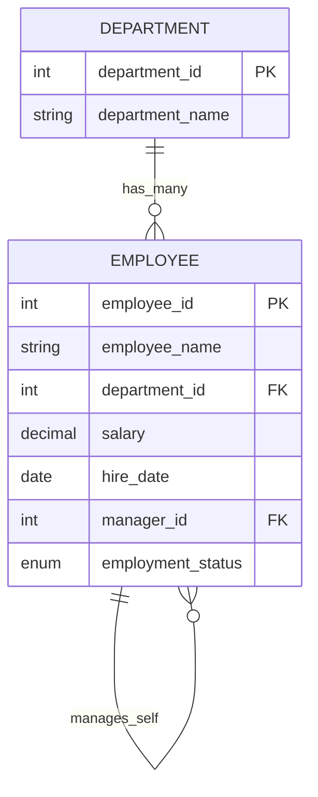

# AI Department Salary Filter

## Overview

This exercise demonstrates how to query employee salary information filtered by department and sorted by salary using SQL JOIN operations.

## Learning Objectives

- Master SQL SELECT statements with multiple tables
- Understand JOIN operations between related tables
- Apply WHERE clause for filtering data
- Use ORDER BY clause for sorting results

## Schema

### ER Diagram (Standard ER Format)



### Tables Structure

**departments**

- `department_id`: Primary Key
- `department_name`: Department name (unique)

**employees**

- `employee_id`: Primary Key
- `employee_name`: Employee name
- `department_id`: Foreign Key to departments
- `salary`: Employee salary
- `hire_date`: Date of hire
- `manager_id`: Foreign Key to employees (self-referencing)
- `employment_status`: 'active' or 'inactive'

## Query Solution

### Problem

Find active employees in the AI department earning more than 60,000. Display `employee_name`, `salary`; sort from highest to lowest.

### Solution

```sql
SELECT e.employee_name, e.salary 
FROM employees e 
JOIN departments d ON e.department_id = d.department_id 
WHERE d.department_name = 'AI' AND e.salary > 60000 
ORDER BY e.salary DESC;
```

## Expected Results

The query returns 3 employees:

| employee_name | salary |
|---------------|--------
| Neha          | 120000 |
| Amol          | 75000  |
| Priya         | 90000  |

Note: Rohan is excluded because his salary (55,000) does not exceed 60,000.

## Important Notes

1. **JOIN is necessary**: To access department_name, we must JOIN with the departments table
2. **Department filtering**: Using department_name instead of hardcoded department_id makes the query more maintainable
3. **Salary threshold**: The query filters for salaries strictly greater than 60,000
4. **Sorting**: Results are ordered by salary in descending order (highest to lowest)
